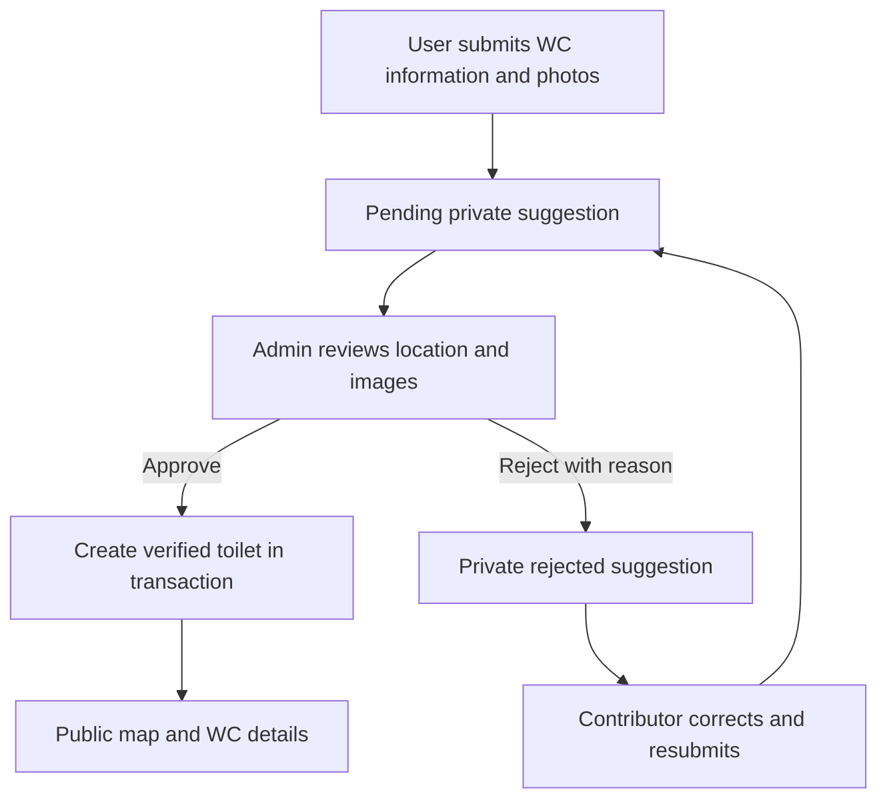

# BackEnd Prompt — ToiletGo KH

> Copy this entire prompt into Codex, Claude Code, or another coding agent.

Act as a senior backend developer, database architect and application security engineer. Build a complete, secure, maintainable REST API for **ToiletGo KH — Smart Public Toilet Finder in Cambodia**. Generate working source code, not just examples.

Read the root `README.md`, inspect the repository and preserve unrelated working code. If frontend code already exists, inspect its API services and types. Keep the API contract consistent with `FrontEnd.md` and document any differences. Build inside `backend/`. Do not use Docker, Docker Compose or containerization. Run directly with Node.js and npm.

## 1. Project information

- Pilot location: Phnom Penh, Cambodia.
- Category: Smart City & Urban Services.
- Currency: Cambodian riel (KHR).
- Timezone: Asia/Phnom_Penh.
- Languages: Khmer and English.
- Purpose: Help residents and tourists find public toilets, view photos and facilities, contribute new WC locations, submit reviews and report maintenance issues.

## 2. Technology stack

Use Node.js, NestJS, TypeScript, Supabase PostgreSQL, Prisma ORM, Supabase Storage, JWT, Passport JWT, Argon2 or Bcrypt, class-validator, class-transformer, Swagger/OpenAPI and Jest. PM2 is optional for direct Ubuntu Server deployment. Choose compatible stable dependency versions and configure Prisma for the version actually installed.

## 3. Authentication and authorization

Implement registration, login, logout, access tokens, refresh-token rotation and revocation, forgot/reset password, change password, current profile, profile update and avatar upload. Implement password reset through an actual configured mail service; do not claim email delivery when SMTP is unavailable.

Roles:

| Role | Permissions |
|---|---|
| USER | Browse verified WCs, submit locations and photos, track own submissions, write reviews, report issues, manage favorites and notifications. |
| MANAGER | Manage assigned WCs only, update facilities and photos, manage cleaning and resolve reports. |
| ADMIN | Manage users, roles, WCs, submissions, assignments, reports, review moderation and analytics. |

Guests can browse verified locations. Public registration always creates a USER. Use JWT guards, role guards and resource ownership checks. Verify signature, expiration, issuer and audience; use an explicitly allowed algorithm. Check current account permissions for sensitive actions, including after role changes. Reject client-supplied role changes through profile updates. Hash passwords and stored refresh/reset tokens. Prefer secure HttpOnly refresh cookies with appropriate CSRF protection and restricted CORS; document the chosen authentication contract for the frontend. Never expose secrets or password hashes.

## 4. Database design

Create a complete Prisma schema, migrations, indexes, constraints and development seed script.

Models:

- User, RefreshToken, PasswordResetToken
- Toilet, ToiletImage, Facility, OpeningHour
- ToiletSuggestion, SuggestionImage
- Review, Report, ReportImage, Favorite
- ManagerAssignment, CleaningSchedule, CleaningLog
- Notification, AuditLog

Enums:

| Enum | Values |
|---|---|
| UserRole | USER, MANAGER, ADMIN |
| SuggestionStatus | PENDING, APPROVED, REJECTED |
| ToiletStatus | OPEN, CLOSED, UNDER_MAINTENANCE |
| AccessType | FREE, PAID, UNKNOWN |
| ReportStatus | PENDING, IN_PROGRESS, RESOLVED, REJECTED |

Include primary keys, foreign keys, creation/update timestamps, unique constraints for favorites, user/WC reviews, manager assignments and published suggestion links. Use nullable fields for genuinely unknown information; unknown accessibility is not equivalent to inaccessible. Use nonnegative integer KHR prices and validate geographic coordinates. Record verification and archive information, suggestion author/reviewer, decision time and rejection reason. Use transactions and database constraints where necessary to preserve consistency.

## 5. Public WC discovery and management

Store WC name, description, address, province, district, Sangkat, latitude, longitude, access type, price in KHR, opening hours, operational status, wheelchair access, water, soap, baby changing facilities, multiple photos, cover image, average rating, cleanliness rating, verification status and last verification date.

Implement create, read, update, archive, search, filters, sorting and pagination. Provide nearby discovery using the Haversine formula or PostGIS with a radius and distance limit. Clearly label geographic distance as approximate straight-line distance rather than walking distance. Evaluate opening hours in Asia/Phnom_Penh, handling overnight hours and unknown schedules. Support filters for price, open now, accessibility, water, soap, rating and radius.

Public endpoints must return only verified, non-archived toilets, never pending or rejected suggestions. Restrict creation of verified WCs to administrators. Managers may update permitted fields on assigned facilities, but cannot independently publish or verify user suggestions.

## 6. User-contributed WC locations

This is a critical requirement. Authenticated users can add missing WC locations with name, description, address, province/district/Sangkat, coordinates, free/paid/unknown access, price, facilities, accessibility, opening hours, multiple photos and additional notes.

Submission workflow:

1. Validate DTOs, coordinates, image ownership and submitted data.
2. Check possible duplicates by proximity and name; flag candidates for review.
3. Store submission photos privately.
4. Create a ToiletSuggestion with status PENDING and authenticated contributor ID.
5. Notify administrators.
6. Return the saved submission and status.

Users can retrieve their own submissions and feedback. They can correct a rejected submission and submit a new request while preserving the original review history. They cannot approve, publish or alter protected status fields. Pending and rejected suggestions and their photos must not be publicly accessible.

## 7. Administrator approval and rejection

Allow administrators to list/filter/search submissions, view contributor details, photos, map coordinates, potential duplicate warnings and submitted information. Allow correction of information during review.

Approval:

1. Verify administrator permissions and current PENDING status.
2. Validate final corrected WC data and image references.
3. Atomically claim the pending suggestion and create a verified Toilet with related facilities, images and opening hours.
4. Set suggestion status to APPROVED and link the published toilet ID.
5. Record administrator ID, review timestamp and audit log.
6. Notify the contributor.
7. Make the published WC and authorized images available through public APIs.

Use a Prisma transaction and unique constraint on the suggestion-to-toilet relationship. Prevent concurrent/repeated requests from creating duplicate toilets. Return a meaningful conflict or an idempotent result on repeated approval. Storage operations are external to database transactions: use private objects with database-controlled access, or implement a reliable publication/cleanup workflow so failed transactions never leak pending images.

Rejection: require a reason, transition only from PENDING, record reviewer/time/audit log, notify contributor and keep the location and photos private. Users cannot approve their own submissions.



## 8. Image uploads and Supabase Storage

Implement actual uploads and image management for WC photos, suggestion photos, maintenance report photos and profile avatars.

Suggested storage buckets or controlled paths: `toilet-images`, `suggestion-images`, `report-images`, `avatars`. Default to private storage for sensitive objects. Use backend authorization to issue short-lived signed URLs for private photos. Only approved, publicly visible WC images may be exposed to guests. Never expose the service-role key to the browser. Avoid relying on unguessable file names as authorization.

- Accept JPG/JPEG, PNG and WebP; verify actual file content, not just MIME header or extension.
- Maximum 5 MB per image and five WC images per submission as proposed defaults.
- Use unique generated object names, safe paths and upload quotas.
- Support multiple photos, cover image, replacement and deletion with ownership checks.
- Strip unnecessary EXIF metadata and optimize large images where practical.
- Store object paths and metadata in PostgreSQL rather than permanent expiring signed URLs.
- Validate uploaded image IDs belong to the submitting user and expected resource type before linking them.
- Handle partial failure, orphan cleanup, duplicate uploads and expired upload references.
- Return image URLs or authorized image access information in API responses, including expiration when relevant.
- Do not attach random internet images to actual WC records. Seed data and its images must be clearly labeled fictional.
- Warn contributors not to photograph people using toilets, private areas, or personally identifying material. Allow moderation and removal of inappropriate images.

Document whether uploads are multipart as part of the submission or a separate authenticated upload followed by image IDs. Keep the frontend contract unambiguous. Provide examples in Swagger.

## 9. Reviews and ratings

Implement create/update/delete own review, public reviews, overall and cleanliness ratings, averages and administrator moderation. Ratings must be integers from 1 to 5. Enforce one review per user/WC with update support. Calculate aggregates from eligible reviews only.

## 10. Maintenance reporting

Allow authenticated users to report dirty toilets, no water, no soap, broken doors/equipment, incorrect location or price, closed toilets and other problems. Store category, description, optional images, status, timestamps, resolution and status history. Users can track their own reports; admins and assigned managers can resolve them. Protect private report photos and contributor information.

## 11. Facility manager system

Implement admin manager assignments, assigned WC listing/details, facility and photo updates, opening hours, operational status, cleaning schedules/logs, maintenance resolution, feedback QR links and assigned-facility statistics. Enforce assignments in every relevant query and mutation, including uploads. QR codes link to a WC feedback page; they do not grant elevated permissions.

## 12. REST API contract

Use `/api` as the global prefix. The following paths are relative to it. Reconcile with existing README and frontend contracts rather than silently creating incompatible names.

| Method | Path | Purpose |
|---|---|---|
| POST | /auth/register | Register USER |
| POST | /auth/login | Authenticate |
| POST | /auth/refresh | Refresh session |
| POST | /auth/logout | Revoke session |
| GET | /auth/me | Current account |
| POST | /auth/forgot-password | Request password reset |
| POST | /auth/reset-password | Reset password |
| PATCH | /me/profile | Update profile |
| POST | /me/change-password | Change password |
| GET | /toilets | Search/filter verified WCs |
| GET | /toilets/nearby | Nearby verified WCs |
| GET | /toilets/:id | WC details |
| GET | /toilets/:id/reviews | Public reviews |
| POST | /toilet-suggestions | Submit location |
| GET | /me/toilet-suggestions | Own submissions |
| GET | /me/toilet-suggestions/:id | Own submission details |
| POST | /toilets/:id/reviews | Create review |
| PATCH | /reviews/:id | Edit own review |
| DELETE | /reviews/:id | Delete own review |
| POST | /toilets/:id/reports | Create report |
| GET | /me/reviews | Own reviews |
| GET | /me/reports | Own reports |
| GET | /me/favorites | Favorites |
| POST | /me/favorites/:toiletId | Add favorite |
| DELETE | /me/favorites/:toiletId | Remove favorite |
| GET | /me/notifications | Notifications |
| PATCH | /me/notifications/:id/read | Mark read |
| GET | /admin/dashboard | Admin statistics |
| GET | /admin/users | Manage users |
| PATCH | /admin/users/:id/role | Change role |
| GET | /admin/suggestions | Review submissions |
| GET | /admin/suggestions/:id | Review details |
| PATCH | /admin/suggestions/:id/status | Approve/reject |
| GET | /admin/toilets | Admin WC inventory |
| POST | /admin/toilets | Create verified WC |
| PATCH | /admin/toilets/:id | Update WC |
| DELETE | /admin/toilets/:id | Archive WC |
| POST | /admin/manager-assignments | Assign manager |
| GET | /admin/reports | Manage reports |
| GET | /admin/analytics | Analytics |
| GET | /manager/dashboard | Manager statistics |
| GET | /manager/toilets | Assigned WCs |
| PATCH | /manager/toilets/:id | Update assigned WC |
| GET | /manager/reports | Assigned reports |
| PATCH | /manager/reports/:id/status | Resolve report |
| POST | /manager/toilets/:id/cleaning-logs | Log cleaning |
| POST | /uploads/toilets | Authorized WC upload |
| POST | /uploads/suggestions | Private submission upload |
| POST | /uploads/reports | Private report upload |
| POST | /uploads/avatar | Avatar upload |
| GET | /health | Health check |

Add supporting endpoints for cleaning schedules, manager assignments, image deletion, moderation and report details. Document actual DTOs, auth and query parameters, including lat/lng naming. Avoid registering dynamic routes that swallow `/nearby`.

Consistent response format, or document the existing format:

```json
{"success":true,"data":{},"message":"Request completed successfully"}
```

Paginated responses include `meta` with `page`, `limit`, `total`, `totalPages`. Errors use accurate HTTP status codes and safe messages. Swagger should describe request/response types, pagination, permissions and image upload examples. Export an OpenAPI specification for the frontend.

## 13. Backend structure

```text
backend/
├── prisma/
│   ├── schema.prisma
│   ├── migrations/
│   └── seed.ts
├── src/
│   ├── auth/
│   ├── users/
│   ├── toilets/
│   ├── toilet-suggestions/
│   ├── reviews/
│   ├── reports/
│   ├── favorites/
│   ├── admin/
│   ├── manager/
│   ├── storage/
│   ├── uploads/
│   ├── notifications/
│   ├── analytics/
│   ├── prisma/
│   ├── config/
│   ├── common/
│   │   ├── guards/
│   │   ├── decorators/
│   │   ├── filters/
│   │   ├── interceptors/
│   │   └── utils/
│   ├── app.module.ts
│   └── main.ts
├── test/
├── .env.example
├── .gitignore
├── package.json
└── README.md
```

Use NestJS modules, controllers, services, DTOs, guards and dependency injection. Keep business logic out of controllers.

## 14. Environment configuration

Create `.env.example` with placeholders, validate required values at startup, and keep real `.env` out of Git.

```dotenv
PORT=3000
NODE_ENV=development
DATABASE_URL=
DIRECT_URL=
JWT_SECRET=
JWT_REFRESH_SECRET=
JWT_EXPIRES_IN=15m
JWT_REFRESH_EXPIRES_IN=7d
JWT_ISSUER=toiletgo-kh
JWT_AUDIENCE=toiletgo-kh-web
SUPABASE_URL=
SUPABASE_SERVICE_ROLE_KEY=
SUPABASE_TOILET_BUCKET=toilet-images
SUPABASE_SUGGESTION_BUCKET=suggestion-images
SUPABASE_REPORT_BUCKET=report-images
SUPABASE_AVATAR_BUCKET=avatars
FRONTEND_URL=http://localhost:5173
ADMIN_EMAIL=
ADMIN_PASSWORD=
SMTP_HOST=
SMTP_PORT=
SMTP_USER=
SMTP_PASSWORD=
```

Use Supabase connection settings appropriate for runtime queries and migrations. Configure Prisma and database seeding for the actual installed version. Keep development and production databases separate. Never hardcode production passwords or run destructive migrations against existing data without authorization.

## 15. Security and privacy

Implement global DTO validation with explicit allowed properties, rate limiting, Helmet, restricted CORS, secure cookies and CSRF defenses if applicable, JWT validation, resource ownership checks, password hashing, refresh-token revocation, parameterized queries, mass-assignment prevention, secure errors, audit logging and upload validation. Never expose database credentials or Supabase service-role keys. Do not retain user GPS history unnecessarily. Test tampered JWT role claims, unauthorized access, unauthorized image retrieval and manager cross-resource access.

## 16. Analytics

Calculate real database statistics: verified WCs, users, pending/approved/rejected suggestions, free/paid WCs, accessible WCs, average cleanliness, unresolved reports, distribution by Phnom Penh district, monthly registrations and monthly submissions. Keep private user data out of public statistics.

## 17. Seed data and testing

Provide development-only fictional Phnom Penh WC data, facility samples, reviews, reports and submissions of each status. Create the admin using environment variables. Use original placeholders for sample images or explicitly label sample photos; never imply invented locations are verified real facilities.

Test authentication, invalid/tampered JWTs, role checks, search/filters, WC submission, image upload validation, private image authorization, admin approval/rejection, concurrent approval, manager ownership, public map visibility, review constraints and pagination. Add integration tests for the complete approval workflow. Use isolated test data; do not mutate production resources. Run lint, Prisma validation, tests, type checking and build. Fix detected errors.

## 18. Installation and deployment — no Docker

Provide instructions to configure Supabase and create storage buckets/policies. Use npm directly:

```bash
cd backend
npm install
npx prisma generate
npx prisma migrate dev --name init
npx prisma db seed
npm run start:dev
```

Configure the seed command for the Prisma version installed. Backend: `http://localhost:3000/api`. Swagger: `http://localhost:3000/api/docs`. Health: `http://localhost:3000/api/health`.

For production, document `npm ci`, Prisma migration deployment, build and `npm run start:prod`. Optionally provide PM2 configuration for Ubuntu Server with HTTPS through a reverse proxy or Cloudflare Tunnel. Do not generate Docker files.

## 19. Final deliverables

Generate complete backend source code, Prisma schema/migrations/seed, secure auth and authorization, all required APIs, actual Supabase Storage integration, transactional WC approval, Swagger/OpenAPI, `.env.example`, tests and backend README. Run validation and build. Report exact tests performed, missing external credentials, missing integrations and remaining blockers honestly. Do not claim a live connection or passing test unless verified.
