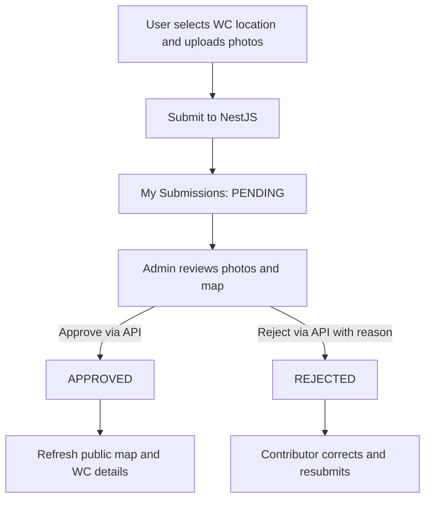

# FrontEnd Prompt — ToiletGo KH

> Copy this entire prompt into Codex, Claude Code, or another coding agent after implementing the backend.

Act as a senior frontend developer, professional UI/UX designer and API integration engineer. Build a complete, modern, visually polished and responsive frontend for **ToiletGo KH — Smart Public Toilet Finder in Cambodia**.

Read the root `README.md` and `BackEnd.md`. Inspect the existing NestJS backend controllers, DTOs, services, Prisma schema and Swagger/OpenAPI documentation before implementing. Generate working source code. Build inside `frontend/` and preserve the backend and unrelated working code.

Connect every supported feature to the **real NestJS REST API**. Do not create another backend, use mock API services in the running application, hardcode fake WC records or statistics, or connect directly to PostgreSQL. Do not use Docker.

## 1. Project information

- Name: ToiletGo KH.
- Category: Smart City & Urban Services.
- Pilot location: Phnom Penh, Cambodia.
- Languages: Khmer and English.
- Currency: KHR.
- Timezone: Asia/Phnom_Penh.
- Platform: Responsive web application for desktop, tablet and mobile.
- Users: Citizens, tourists, facility managers and administrators.

## 2. Technology stack

Use Vue.js 3, TypeScript, Vite, Vue Router, Pinia, Tailwind CSS, Axios, Leaflet, OpenStreetMap, Vue I18n, Lucide Icons, Chart.js and Vitest. Use Vue Composition API with `<script setup lang="ts">`. Choose compatible stable package versions and preserve the existing conventions if the frontend already exists.

## 3. UI/UX design and visual direction

Create a premium, minimal and accessible interface inspired by location cards and photo galleries, a map-first discovery experience and a modern SaaS administrator dashboard. Do not copy proprietary interfaces exactly.

| Design token | Value |
|---|---|
| Primary | #059669 |
| Primary dark | #047857 |
| Secondary | #064E3B |
| Light background | #F8FAFC |
| White | #FFFFFF |
| Dark background | #0F172A |
| Main text (light mode) | #0F172A |
| Muted text (light mode) | #64748B |
| English font | Inter |
| Khmer font | Noto Sans Khmer |

Use rounded cards, consistent spacing, subtle shadows, strong typography, responsive grids, light/dark mode, keyboard-accessible controls, visible focus states, skeleton loading, empty states, toast notifications and confirmation dialogs. Ensure contrast and Khmer line heights remain readable. Avoid excessive gradients and animation. Respect reduced-motion settings.

## 4. Images, logo and visual assets

The website must have a professional visual identity, images and illustrations, not just text and empty boxes.

Create this asset structure (or equivalent):

```text
public/
├── images/
│   ├── hero/
│   │   ├── phnom-penh-hero.webp
│   │   └── public-restroom-hero.webp
│   ├── illustrations/
│   │   ├── find-toilet.svg
│   │   ├── add-location.svg
│   │   ├── waiting-approval.svg
│   │   ├── location-approved.svg
│   │   └── empty-results.svg
│   ├── placeholders/
│   │   ├── toilet-placeholder.webp
│   │   └── avatar-placeholder.svg
│   └── branding/
│       ├── toiletgo-logo.svg
│       └── toiletgo-logo-dark.svg
└── icons/
    ├── wc-marker.svg
    ├── accessible-marker.svg
    ├── free-wc-marker.svg
    ├── paid-wc-marker.svg
    └── favicon.svg
```

Visual asset requirements:

- Use a high-quality, properly licensed Phnom Penh city photograph for the homepage hero if available; otherwise create an original city illustration.
- Create a custom logo combining a map pin and WC/restroom symbol, emerald green and white, with light/dark variants and a favicon.
- Create original SVG illustrations for searching, adding locations, waiting for approval, approved submissions, errors and empty results.
- Display actual WC cover photos, galleries, contributor avatars and maintenance images returned by the backend.
- Use Supabase Storage URLs or authorized signed URLs provided by the API. Refresh expired signed URLs through the supported API when necessary.
- Never use unrelated stock restroom images as photographs of actual verified facilities. Use an explicitly labeled placeholder if a record has no real photo.
- Use responsive sizes, WebP optimization where appropriate, lazy loading for noncritical images, alt text, stable aspect ratios and fallback images.
- Download/use only assets with suitable permission; document source URLs, license and attribution in `ASSETS.md`. Do not invent assets, sources or licenses. If access is unavailable, create original SVG assets and adjust filenames accordingly.
- Keep private pending/rejected submission and maintenance photos out of public pages and unauthorized caches.

Provide a warning during photo submission: do not photograph people using toilets, private areas or personally identifying material.

### Visual layout references (implement these as actual responsive components)

Homepage:

```text
┌────────────────────────────────────────────────────────┐
│ ToiletGo KH     Home   Explore   Add WC     EN/KM  ☾  │
├────────────────────────────────────────────────────────┤
│                 PHNOM PENH CITY HERO                   │
│         Find a clean public toilet near you           │
│       [ Search location ] [ Use my location ]         │
│                    [ Explore Map ]                     │
├────────────────────────────────────────────────────────┤
│ Free       Open now       Accessible       Top rated  │
│ [ WC photo ]       [ WC photo ]       [ WC photo ]    │
│ Name · distance    Name · distance    Name · distance │
│ Rating · price     Rating · price     Rating · price  │
├────────────────────────────────────────────────────────┤
│     How it works · illustrations · Add WC CTA         │
└────────────────────────────────────────────────────────┘
```

Explore map (desktop):

```text
┌────────────────────────────────────────────────────────┐
│ Search toilets             Filters       My location  │
├───────────────────┬────────────────────────────────────┤
│ Nearby toilets    │                                    │
│ [Photo] WC card   │          INTERACTIVE MAP           │
│ Distance / price  │         WC pin      WC pin         │
│ [Photo] WC card   │              Current GPS           │
│ Rating / features │                       WC pin       │
│ Pagination        │   Zoom controls · OSM attribution  │
└───────────────────┴────────────────────────────────────┘
```

Admin approval page:

```text
┌────────────┬───────────────────────────────────────────┐
│ Sidebar    │ Review WC submission        PENDING       │
│ Dashboard  │ [ Cover photo ] [ Photo gallery ]         │
│ WCs        │ Name, contributor, address, facilities    │
│ Submissions│ [ Interactive map preview ]               │
│ Users      │ Opening hours · price · duplicate check   │
│ Reports    │ [ Edit details ] [ Reject ] [ Approve ]   │
└────────────┴───────────────────────────────────────────┘
```

The layouts are design guidance, not sample database records. On mobile, adapt to a single column, touch-friendly controls, map bottom sheet and compact navigation.

## 5. Backend API integration

Before coding, inspect the real backend and Swagger/OpenAPI. Identify actual endpoints, request DTOs, response envelopes, pagination, auth flow, roles, image upload formats, image URLs and error formats. Generate corresponding TypeScript types. Use actual API contracts rather than assuming all proposed paths exist.

Development URLs:

- Frontend: `http://localhost:5173`
- Backend: `http://localhost:3000/api`
- Swagger: `http://localhost:3000/api/docs`

Create `.env.example`:

```dotenv
VITE_APP_NAME=ToiletGo KH
VITE_API_BASE_URL=http://localhost:3000/api
VITE_DEFAULT_LATITUDE=11.5564
VITE_DEFAULT_LONGITUDE=104.9282
VITE_DEFAULT_MAP_ZOOM=13
```

The coordinates are a proposed initial map center, not the user's location. Ask permission before accessing GPS. Allow manual search if geolocation is denied. Never expose DATABASE_URL, JWT_SECRET, SUPABASE_SERVICE_ROLE_KEY or private storage credentials to the browser.

Create centralized Axios API client at `src/services/api.ts` with environment-based URL, timeout, typed responses, request/response interceptors, upload progress and safe error handling. Attach access tokens as required by the backend. Enable credentials only if cookie auth is supported. Use one shared in-flight refresh request to prevent simultaneous refresh calls; retry a failed authenticated request at most once after successful refresh. Do not retry login/refresh endlessly. Clear the session if refresh fails.

Example client (adapt to the actual backend):

```ts
import axios from 'axios'

export const api = axios.create({
  baseURL: import.meta.env.VITE_API_BASE_URL,
  timeout: 15000,
  headers: { Accept: 'application/json' },
})
```

Use `/toilets` relative to the base URL, not `/api/toilets`, to avoid a duplicated prefix. Verify actual nearby query parameters and upload request formats. Handle 400, 401, 403, 404, 409, 422, 429 and 500 responses. Never display backend stack traces. If an endpoint is missing, document it and gracefully disable the unsupported action; do not invent endpoints or silently return fake data.

## 6. Application layouts

- PublicLayout: logo, responsive header, home, explore, add WC, about, language/theme switcher, login/register or account menu, mobile bottom navigation, footer.
- UserLayout: dashboard, submissions, favorites, reviews, reports, notifications and profile.
- AdminLayout: collapsible sidebar, top bar, breadcrumbs, notifications, profile menu and responsive content.
- ManagerLayout: dashboard, assigned WCs, maintenance, cleaning and profile.

## 7. Public homepage

Include a Phnom Penh hero image or illustration, headline `Find a clean public toilet near you`, supporting description, location search, use-my-location and explore-map actions. Display nearby and popular WCs with actual cover images, name, address, rating, price in KHR, distance when known, operational status, accessibility and details link. Add quick categories for free, paid, open now, accessible and highly rated toilets. Include illustrated how-it-works and contribution sections, real platform statistics only if supported, and footer. Do not fabricate statistics or WC availability.

## 8. Explore map page

Use Leaflet and OpenStreetMap. Default to Phnom Penh with real verified WC markers. Desktop: list sidebar and map. Mobile: full-width map, list/bottom sheet, search/filter controls, GPS button.

Implement search by name/address, current location with permission, custom WC marker icons, clustering when necessary, map popups with images, distance sorting, radius, filters for price, open status, cleanliness, wheelchair access, water and soap, map/list toggle, favorites and navigation. Show loading/error/empty states. Distinguish approximate straight-line distances from walking route distances. Use external directions when supported. Respect OpenStreetMap attribution and tile usage requirements. Never expose pending or rejected suggestions on the map.

## 9. WC details page

Create large cover photo, gallery and full-screen accessible image viewer, name, address, verification badge, overall and cleanliness ratings, distance, price, opening hours, operational status, last verification date and interactive map. Show available facilities: water, soap, wheelchair accessibility and baby changing facilities, distinguishing unknown values.

Actions: get directions, save/remove favorite, share link, write review, report issue. Display actual reviews and use a labeled fallback when no WC photo exists. Do not show an open-now label when opening information is unknown.

## 10. Authentication

Create LoginView.vue, RegisterView.vue, ForgotPasswordView.vue and ResetPasswordView.vue with logo, original illustration, validated forms, password visibility toggle, loading/error states and session restoration.

Connect to actual authentication routes for login, registration, refresh, logout, current user, forgot/reset password. Use backend-provided role information. Registration creates USER accounts only. Redirect USER to `/`, ADMIN to `/admin/dashboard`, MANAGER to `/manager/dashboard`, or return to an authorized intended route. Guests can browse public WCs; protected actions require login. Handle unauthorized/expired sessions securely.

## 11. User dashboard

Show actual profile/avatar, welcome message, submission counts by status, favorite WC photos, recent reviews and reports, notifications and links to actions. Retrieve data from the backend.

## 12. Add WC location — critical user contribution feature

Build `AddToiletView.vue` as a mobile-friendly multi-step form with clear progress and validation.

1. Basic information: WC name, description, address, province, district, Sangkat, notes.
2. Location: click-to-select map pin, draggable marker, use current GPS, latitude and longitude.
3. Access/facilities: free/paid/unknown, KHR price, opening hours, water, soap, wheelchair access, baby changing facilities; allow unknown values when supported.
4. Photos: drag/drop, browse, mobile camera input, multiple previews, select cover, remove selected images, validation and upload progress. Match backend limits (proposed five images, 5 MB each, JPG/PNG/WebP). Revoke local object URLs after use.
5. Review: display location, details and photos before submitting.

Connect to real suggestion and upload endpoints using actual multipart/form-data or uploaded-image-ID contract. Never manually set an incorrect multipart boundary. Prevent duplicate form submission and handle failed uploads gracefully.

After a successful API response, show an original waiting-for-approval illustration and message: `Your WC location has been submitted successfully and is waiting for administrator approval.` Redirect to My Submissions.

Never publish the pending location directly to the public map. The backend is the source of truth for status and visibility.

## 13. My Submissions

List only the authenticated user's submissions, with photo, name, address, date, status and administrator feedback. Provide details and pagination if supported.

| Status | UI | Action |
|---|---|---|
| PENDING | Yellow badge and waiting illustration | Track status; no public map link |
| APPROVED | Green badge | Link to actual published WC details |
| REJECTED | Red badge and reason | Correct and submit a new suggestion |

Keep original rejection history. Do not allow users to set approval status or view another user's private submission.

## 14. Other user pages

Create MyFavoritesView.vue, MyReviewsView.vue, MyReportsView.vue, NotificationsView.vue, ProfileView.vue and ChangePasswordView.vue. Connect real API data and use images where relevant. Support removing favorites, editing/deleting own reviews, tracking report status/resolution, reading approval/rejection notifications, marking notifications read, updating profile/avatar and changing password. Persist theme and language preference.

Report problem form: category, description, optional multiple photo uploads/previews, validation and submit. Categories include dirty toilet, no water, no soap, broken door/equipment, incorrect location/price, closed facility and other. Display success only when the backend confirms.

## 15. Administrator dashboard

Build a modern SaaS dashboard with sidebar items: Dashboard, WC Locations, Pending/Approved/Rejected Submissions, Users, Facility Managers, Manager Assignments, Reviews, Maintenance Reports, Analytics and Settings.

Display actual API statistics: total WCs/users, pending/approved/rejected suggestions, free/paid WCs, accessible locations, unresolved reports, average cleanliness. Chart monthly submissions/registrations, approval status, district distribution and report status using Chart.js. Include recent submission cards with private images available to the authorized admin. Provide empty states instead of fake statistics.

## 16. Administrator WC approval page — critical feature

Create a searchable, filterable, paginated submission table showing WC thumbnail, name, contributor avatar/name, address, date, status and actions. Create a review detail screen with photo gallery, full-screen viewer, contributor details, WC details, map preview, coordinates, opening hours, facilities, accessibility, price and duplicate warnings if provided by the backend.

Approval action: confirm, send real approval request, wait for successful backend response, refresh submissions, WC inventory, dashboard statistics and public WC data; show success. Handle conflicts if another admin already processed the suggestion.

Rejection action: require reason, confirm, submit backend request, refresh status and display feedback. Rejected submissions stay hidden. Support admin corrections during review according to backend DTOs. Never update status only in frontend state or publish before backend success.



## 17. Administrator WC and user management

WC management: view/search/filter/paginate inventory including archived records where supported, add verified WC, edit data, archive, change status, upload/delete images, choose cover photo, manage facilities/opening hours and manager assignments. Include WC thumbnails. Use administrator endpoints, not public endpoints for private/archived data.

User management: view/search/filter users and avatars, view account details, update roles, assign facility managers and confirm sensitive actions. Include review moderation and maintenance report management. Never rely solely on hidden buttons or route guards for authorization.

## 18. Facility manager dashboard

Create manager dashboard, assigned WC listing/details, photo management, cleaning schedule/history, maintenance reports, ratings and reviews, feedback QR links and profile settings. Connect to real manager endpoints. Managers must only see and modify assigned facilities, according to backend permissions. Handle 403 responses safely.

## 19. Expected REST API integration

Use the actual paths confirmed in the backend. These are proposed paths relative to `VITE_API_BASE_URL`:

| Area | Methods and paths |
|---|---|
| Auth | POST /auth/register, /auth/login, /auth/refresh, /auth/logout, /auth/forgot-password, /auth/reset-password; GET /auth/me |
| Profile | PATCH /me/profile; POST /me/change-password |
| Public WCs | GET /toilets, /toilets/nearby, /toilets/:id, /toilets/:id/reviews |
| Suggestions | POST /toilet-suggestions; GET /me/toilet-suggestions, /me/toilet-suggestions/:id |
| Reviews | POST /toilets/:id/reviews; PATCH and DELETE /reviews/:id; GET /me/reviews |
| Reports | POST /toilets/:id/reports; GET /me/reports |
| Favorites | GET /me/favorites; POST and DELETE /me/favorites/:toiletId |
| Notifications | GET /me/notifications; PATCH /me/notifications/:id/read |
| Admin submissions | GET /admin/suggestions, /admin/suggestions/:id; PATCH /admin/suggestions/:id/status |
| Admin WCs | GET and POST /admin/toilets; PATCH and DELETE /admin/toilets/:id |
| Admin accounts | GET /admin/users; PATCH /admin/users/:id/role; POST /admin/manager-assignments |
| Admin statistics/reports | GET /admin/dashboard, /admin/analytics, /admin/reports |
| Manager | GET /manager/dashboard, /manager/toilets, /manager/reports; PATCH /manager/toilets/:id, /manager/reports/:id/status; POST /manager/toilets/:id/cleaning-logs |
| Images | POST /uploads/toilets, /uploads/suggestions, /uploads/reports, /uploads/avatar |
| Health | GET /health |

Inspect supporting endpoints for moderation, assignments, image management and cleaning. Do not invent functionality where the backend lacks support. Document mismatches in `API-INTEGRATION.md`.

## 20. API services and state management

```text
src/services/
├── api.ts
├── auth.service.ts
├── toilet.service.ts
├── suggestion.service.ts
├── review.service.ts
├── report.service.ts
├── favorite.service.ts
├── notification.service.ts
├── user.service.ts
├── admin.service.ts
├── manager.service.ts
└── upload.service.ts
```

Create Pinia stores for auth, toilets, suggestions, favorites, notifications, admin, manager, theme and language. Use local component state for temporary UI/form state. Keep access tokens in memory where practical, follow the actual backend's session design and prefer HttpOnly refresh cookies. Do not store secrets or trust localStorage role values. Clear private data on logout/account changes.

## 21. Vue Router

Public: `/`, `/explore`, `/toilets/:id`, `/about`, `/login`, `/register`, `/forgot-password`, `/reset-password`.

User: `/dashboard`, `/add-toilet`, `/my-submissions`, `/my-submissions/:id`, `/favorites`, `/my-reviews`, `/my-reports`, `/notifications`, `/profile`.

Admin: `/admin/dashboard`, `/admin/toilets`, `/admin/toilets/new`, `/admin/toilets/:id`, `/admin/submissions`, `/admin/submissions/:id`, `/admin/users`, `/admin/managers`, `/admin/reviews`, `/admin/reports`, `/admin/analytics`, `/admin/settings`.

Manager: `/manager/dashboard`, `/manager/toilets`, `/manager/toilets/:id`, `/manager/cleaning`, `/manager/reports`, `/manager/profile`.

Implement route metadata (`requiresAuth`, `allowedRoles`, `guestOnly`), authorization-aware navigation, lazy-loaded routes, illustrated 403/404 pages and protected action redirects. Frontend guards improve UX; backend authorization remains mandatory.

## 22. Reusable UI components

Create AppButton, AppInput, AppSelect, AppModal, AppCard, AppBadge, AppPagination, AppDataTable, AppSkeleton, AppToast, AppEmptyState, AppImage, ImageGallery, ImageUploader, MapView, MapPicker, ToiletCard, ToiletMarker, RatingStars, StatusBadge, ConfirmDialog, LanguageSwitcher and ThemeSwitcher. Add accessible form labels, validation messages, dialogs, responsive layouts and consistent loading states. Avoid duplicated code and nonfunctional placeholder buttons.

## 23. Khmer and English support

Use Vue I18n with `src/locales/en.json` and `src/locales/km.json`. Translate navigation, labels, buttons, errors, notifications, statuses, instructions, empty states and dashboard headings. Allow instant language switching and persist preferences. Format KHR prices and date/time correctly. Use appropriate Khmer fonts and spacing.

## 24. Security and privacy

Never expose backend credentials or connect directly to the database. Retrieve account roles from the authenticated backend. Handle token refresh and session expiry securely. Do not render untrusted HTML or store precise GPS history without explicit consent. Request geolocation permission and allow manual alternatives. Use HTTPS in production (browser geolocation requires a secure context apart from localhost). Protect private images, validate file types/sizes, avoid leaking auth tokens in URLs, respect rate limiting and configure CORS with the backend. Treat all frontend validation as supplementary to backend enforcement.

## 25. Project structure

```text
frontend/
├── public/
│   ├── images/
│   └── icons/
├── src/
│   ├── assets/
│   ├── components/
│   │   ├── common/
│   │   ├── map/
│   │   ├── toilet/
│   │   ├── images/
│   │   ├── forms/
│   │   ├── charts/
│   │   └── admin/
│   ├── composables/
│   ├── layouts/
│   ├── views/
│   │   ├── public/
│   │   ├── auth/
│   │   ├── user/
│   │   ├── admin/
│   │   ├── manager/
│   │   └── errors/
│   ├── router/
│   ├── stores/
│   ├── services/
│   ├── types/
│   ├── locales/
│   ├── utils/
│   ├── App.vue
│   └── main.ts
├── tests/
├── .env.example
├── .gitignore
├── index.html
├── package.json
├── vite.config.ts
├── tsconfig.json
├── ASSETS.md
├── API-INTEGRATION.md
└── README.md
```

## 26. Testing and acceptance criteria

Test login/registration, session persistence and refresh, route guards, real API connectivity, map/GPS, WC search/filters, gallery/upload previews, WC submission, admin approval/rejection, public visibility, favorites, reviews, reports, manager restrictions, private image access, Khmer/English translations and desktop/tablet/mobile layouts, light/dark mode and accessibility. Use isolated test data and test-only fixtures where needed; no mock services in the actual application.

End-to-end critical scenario:

1. Log in as USER and submit a WC with map pin and photos.
2. Confirm PENDING in My Submissions and absence from public discovery.
3. Log in as ADMIN and inspect the submission and photos.
4. Approve through the real API; verify the public map contains the newly verified WC after refresh.
5. Repeat with a different suggestion and reject with a reason; verify that the contributor receives feedback and the location remains private.
6. Verify USER cannot access approval endpoints and MANAGER cannot access unrelated facilities.

Run linting, TypeScript type checking, tests and production build. Fix errors and document what could not be verified because of missing backend services or credentials.

## 27. Installation and running — no Docker

With the backend already running and configured:

```bash
cd frontend
npm install
npm run dev
```

Open `http://localhost:5173`. Backend API: `http://localhost:3000/api`. Ensure NestJS CORS allows the frontend origin. Set the production API URL through Vite configuration before building.

```bash
npm run build
npm run preview
```

Preview is for checking the production build locally. Document static hosting and SPA route fallback for actual deployment. Do not create Docker-related files.

## 28. Final deliverables

Generate complete frontend source code, professional UI with local branding and licensed/original images, real backend integration, actual WC galleries and image uploads, public/user/admin/manager pages, submission approval workflow, responsive map, Khmer and English translations, light/dark themes, reusable components, `.env.example`, tests, frontend README, asset attribution and API integration documentation.

Run tests and build; report exact results, unavailable assets, missing APIs, credentials and integration blockers honestly. Preserve the existing backend. Do not use Docker or mock runtime APIs. The real backend must be the sole source of WC records, approvals, user permissions and platform statistics.
